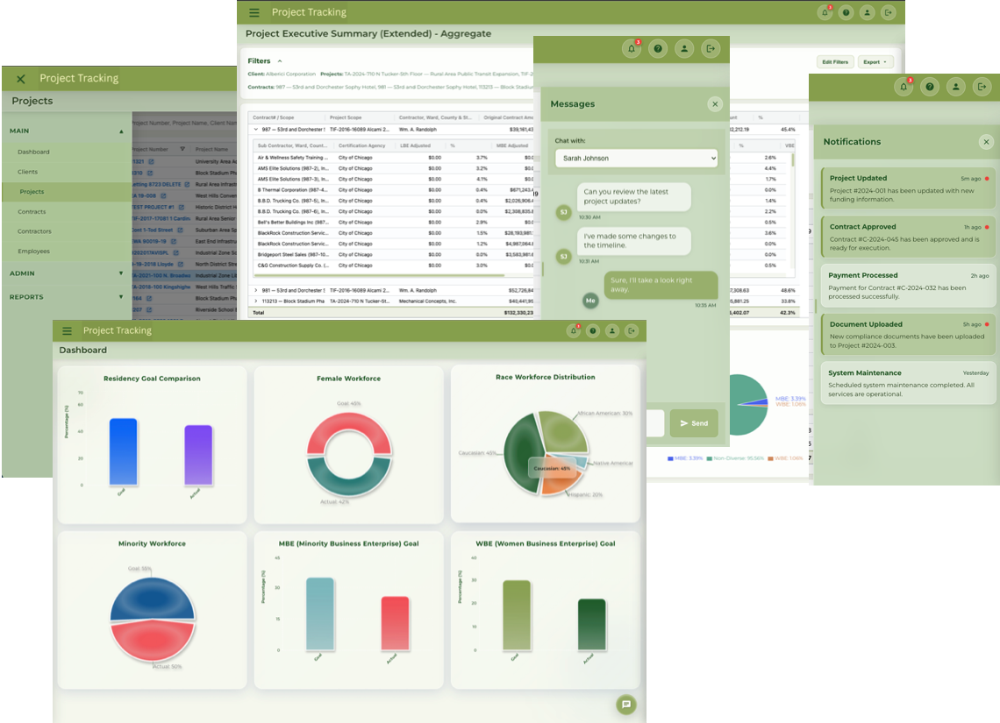

# GPTS Demo App — Construction Compliance Tracker

A client-side demo application for the Construction Compliance Tracking domain, built with React 19 and a glassmorphism UI aesthetic. All data is served from local JSON files (no backend required).

---

## Live Demo

[https://ccd.thanish.com/](https://ccd.thanish.com/)

## Screenshot



---

## Tech Stack

| Layer | Technology |
|---|---|
| UI Framework | React 19.2.0 |
| Routing | React Router DOM 7.9.5 (`createBrowserRouter`) |
| Build Tool | Create React App (react-scripts 5.0.1, webpack) |
| Language | JavaScript (no TypeScript) |
| Data Grid | AG Grid 34.3.1 |
| Charts | Recharts 3.4.1 |
| Select Input | React Select 5.10.2 |
| Notifications | React Toastify 11.0.5 |
| Tooltips | React Tooltip 5.30.0 |
| PDF Export | jsPDF 3.0.3 + jspdf-autotable 5.0.2 |
| Canvas Capture | html2canvas 1.4.1 |

---

## Features

- **Dashboard** — Workforce diversity metrics (residency goals, female/minority/MBE/WBE comparisons) rendered as bar and pie charts. Charts are styled to give a 3D appearance using layered gradients and depth shadows — no third-party 3D library, just Recharts customization.

- **Projects** — AG Grid table with search, filter, quick-details slide-in panel, create form, and 9 detail tabs (Details, Funding, Goals, Award Criteria, Wages & Trades, Bid Packages, Contracts, Attachments, Notes)

- **Contracts** — AG Grid table with 12 detail tabs (Details, Contractors, Commitments, Employees, Site Visits, Payrolls, Change Orders, Payments, Data Import, Address Map, Attachments, Notes)

- **Reports** — Project Executive Summary rendered as a dynamic, multi-table report with nested table structures that reflect the shape of the data at runtime. The entire report — including all tables and the live Recharts charts — is exported to PDF entirely in the browser using jsPDF + html2canvas. The PDF captures the charts with their actual rendered styles (gradients, colors, layout) as they appear on screen, with no server-side rendering involved.

- **Messaging** — In-app messaging panel with conversation threads

- **Notifications** — In-app notification list with unread status tracking

---

## Setup & Running Locally

```bash
git clone <repo-url>
cd gpts-demo-app
npm install
npm start          # Dev server at http://localhost:4001
npm run build      # Production build → /build
```

Node.js 22.19.0 is specified in `.tool-versions` (managed via asdf). Any Node 18+ should work.

---

## React 19 — Concepts Tracker

The app runs on React 19.2.0. The current implementation uses React 18-style hooks (`useState`, `useEffect`, `useRef`, `useCallback`, `useMemo`). The table below tracks React 19 concepts planned for hands-on practice as the app evolves.

| Concept | Where it fits in this app | Status |
|---|---|---|
| `useActionState` | Replace the create-project and create-contract forms | Planned |
| `useOptimistic` | Optimistic row updates in AG Grid on create/edit | Planned |
| `use()` hook | Unwrap data promises in report and detail components | Planned |
| Form Actions (async `action` prop) | Form submissions without explicit event handlers | Planned |
| `useFormStatus` | Disable/loading state on submit buttons during async actions | Planned |

---

## Design & CSS

The UI — color theme, layout, spacing, and glassmorphism treatment — was designed from scratch. No UI kit or template was used. The glassmorphism style (frosted glass panels, layered transparency, backdrop blur) was applied consistently across the dashboard, sidebars, modals, and forms. The color palette, typography choices, and component-level visual decisions were all made and implemented by hand.

**CSS implementation approach:**
- **Plain vanilla CSS** — no Sass, no Tailwind, no CSS-in-JS library
- **CSS custom properties** (`--color-text-primary`, `--color-surface`, `--color-accent`, etc.) defined in `:root` in `App.css` serve as the design token system for consistent theming
- **Inline `style` objects** used within components for dynamic values (chart colors, computed dimensions, animation states) where static class names aren't practical
- Glassmorphism properties (`backdrop-filter: blur()`, `rgba()` backgrounds, layered `box-shadow`) are written directly in the stylesheet, keeping the visual logic visible and easy to adjust

---

## Purpose

This project is hands-on practice with two specific goals. First, to implement the glassmorphism design trend — one of the most widely recognized UI styles of 2025 — and see how far it can be taken in a real, multi-page application rather than a single demo card. Second, to work through core React concepts (component composition, hooks, routing, state management, data-driven rendering) by applying them to a realistic domain with enough complexity to surface the tradeoffs. The construction compliance tracking domain was chosen because it has rich data relationships that stress-test both the UI and the component architecture.
